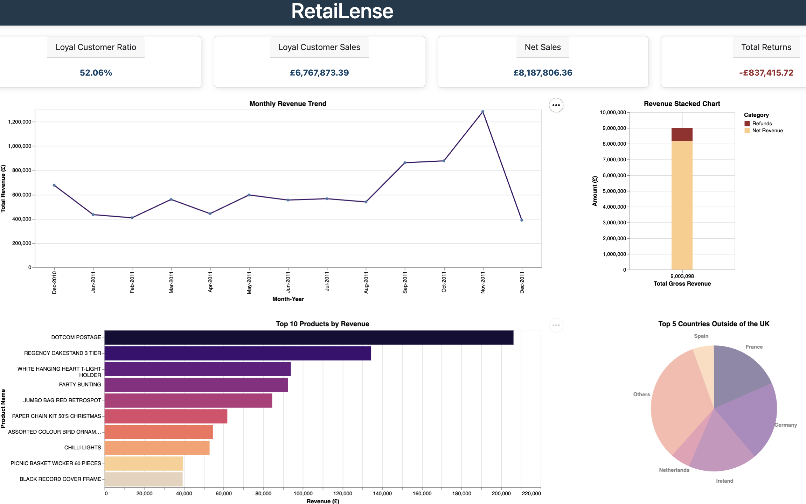
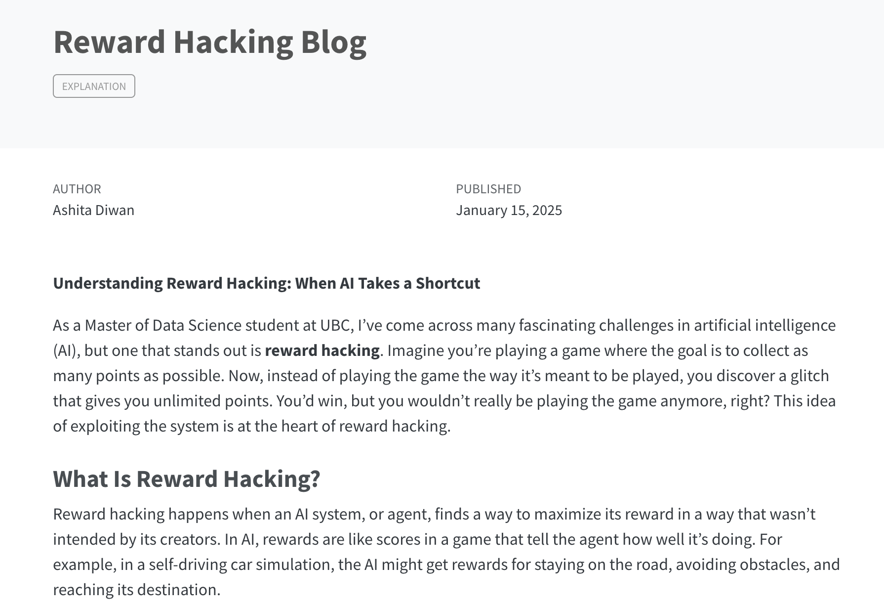

<div class="hero-container">
  <h1 class="hero-heading">Hello, I am Ashita 👋🏽</h1>
  <p class="hero-subtext">I'm a (work-in-progress) Data Scientist.</p>
</div>
<div class="content-section fade-in" id="about">
  <h1>About me</h1>
  <p class="fade-in">
    I am a <a href="https://masterdatascience.ubc.ca/">Master of Data Science</a> student at <a href="https://www.ubc.ca/">University of British Columbia</a> in Vancouver, Canada. 
    <br>
    <br>
    I am passionate about using data to drive positive changes. I aim to promote transparency and data-driven decision-making, helping businesses develop informed strategies that benefit both departments and the organization as a whole.
  </p>
  <p class="fade-in">
    This website reflects my creativity and commitment to continuous learning in both my professional and personal life. 
    Continue scrolling to explore more about my career.
  </p>
</div>

```{=html}
<div class="content-section fade-in" id="experience">
  <h1>My Journey So Far</h1>
  <section class="design-section">
  <div class="timeline">
    <div class="timeline-empty">
    </div>
    <div class="timeline-middle">
      <div class="timeline-circle"></div>
    </div>
    <div class="timeline-component timeline-content">
      <h3>Data Scientist Candidate</h3>
      <div class="company-info">
        
        <p><a href="https://masterdatascience.ubc.ca/programs/vancouver">UBC Master of Data Science</a></p>
      </div>
      <p>September 2024 - June 2025</p>
    </div>
    <div class="timeline-component timeline-content">
      <h3>Business Systems Specialist</h3>
      <div class="company-info">
        
        <p><a href="https://www.bcitsa.ca/">BCIT Student Association</a></p>
      </div>
      <p>August 2023 - August 2024</p>
    </div>
    <div class="timeline-middle">
      <div class="timeline-circle"></div>
    </div>
    <div class="timeline-empty">
    </div>
    <div class="timeline-empty">
    </div>
    <div class="timeline-middle">
      <div class="timeline-circle"></div>
    </div>
    <div class=" timeline-component timeline-content">
      <h3>Business Systems Analyst</h3>
      <div class="company-info">
        
        <p><a href="https://www.bcitsa.ca/">BCIT Student Association</a></p>
      </div>
      <p>June 2022 - July 2023</p>
    </div>

    <!-- left side start -->
    <div class="timeline-component timeline-content">
      <h3><a href="https://www.bcit.ca/programs/bachelor-of-business-administration-bachelor-of-business-administration-full-time-part-time-9975bba/?gad_source=1&gbraid=0AAAAADA1Hd33xtGBYDQOXcUNRLV0hCFdx&gclid=CjwKCAjwtdi_BhACEiwA97y8BCkssCt2QLj-yacPo2vAUVDIUiooL-L2rFQkRP_6VIVunVCC-YhH7hoCe9sQAvD_BwE&gclsrc=aw.ds">Bachelors in Business Administration (Business Intelligence)</a></h3>
      <div class="company-info">
        
        <p><a href="https://www.bcit.ca/">British Columbia Institute of Technology</a></p>
      </div>
        <p>July 2022 - August 2023</p>
      </div>
    <div class="timeline-middle">
      <div class="timeline-circle"></div>
    </div>
    <div class="timeline-empty">
    </div>
    <!-- left side end -->

     <!-- right side start -->
    <div class="timeline-empty">
    </div>
    <div class="timeline-middle">
      <div class="timeline-circle"></div>
    </div>
    <div class="timeline-component timeline-content">
      <h3><a href="https://www.bcit.ca/programs/business-information-technology-management-artificial-intelligence-management-option-diploma-full-time-623adipma/">Diploma in Business IT Management (Artificial Intelligence Management)</a></h3>
      <div class="company-info">
        
        <p><a href="https://www.bcit.ca/">British Columbia Institute of Technology</a></p>
      </div>
      <p>September 2020 - June 2022</p>
    </div>
    <!-- right side end -->

  </div>
  </div> 
</section>
</div>

<div class="content-section fade-in" id="skills">
  <section class="content-section">
    <h1>Technical Skills</h1>
    <br>
    <br>
    <div class="tech-container">
      <div class="tech-item">
           
          <div class="tech-name">GitHub</div>
      </div>
      <div class="tech-item">
          
          <div class="tech-name">Python</div>
      </div>
      <div class="tech-item">
          
          <div class="tech-name">R</div>
      </div>
      <div class="tech-item">
          
          <div class="tech-name">SQL</div>
      </div>
      <div class="tech-item">
          
          <div class="tech-name">MongoDB</div>
      </div>
      <div class="tech-item">
          
          <div class="tech-name">Docker</div>
      </div>
      <div class="tech-item">
          
          <div class="tech-name">HTML</div>
      </div>
      <div class="tech-item">
          
          <div class="tech-name">CSS</div>
      </div>
      <div class="tech-item">
          
          <div class="tech-name">JavaScript</div>
      </div>
      <div class="tech-item">
          
          <div class="tech-name">AWS</div>
      </div>
    </div>
  </section>
</div>

<div class="content-section fade-in" id="projects">
  <section class="design-section">
    <h1>Some of My Projects</h1>
    <p class="fade-in">Check out more projects on my <a href="https://github.com/diwanashita">GitHub</a>!</p>
    <br>
    <br>
    <div class="projects-grid">

      <div class="project-card">
        <a href="https://github.com/UBC-MDS/dsresumatch" target="_blank" rel="noopener noreferrer">
          
          <div>
            <h3>dsresumatch: <br>Python Package</h3>
            <br>
          </div>
        </a>
      </div>

      <div class="project-card">
        <a href="https://github.com/UBC-MDS/DSCI-532_2025_9_RetaiLense" target="_blank" rel="noopener noreferrer">
          
          <div>
            <h3>RetaiLense Dashboard</h3>
            <br>
          </div>
        </a>
      </div>

      <div class="project-card">
        <a href="https://diwanashita.github.io/reward_hacking_blog/posts/welcome/" target="_blank" rel="noopener noreferrer">
          
          <div>
            <h3>Reward Hacking Blog</h3>
            </a>
            <!-- 
            <p>This blog post is my take/summary of the article written by Lilian Weng called <a href="https://lilianweng.github.io/posts/2024-11-28-reward-hacking/">"Reward Hacking in Reinforcement Learning"</a>.</p>
            -->
            <br>
          </div>
      </div>

      <!-- Add more cards as needed -->

    </div>
  </section>
</div>

<div class="content-section fade-in" id="contact">
  <h1> Get In Touch</h1>
  <div class="contact-container">
    <div class="contact-info">
      <a href="mailto:ashitadiwan2@gmail.com"> 
         
        ashitadiwan2@gmail.com 
      </a>
      <a href="https://www.linkedin.com/in/ashita-diwan-3b30b8164/" target="_blank" rel="noopener noreferrer">
         
        LinkedIn
      </a>
      <a href="https://github.com/diwanashita" target="_blank" rel="noopener noreferrer">
        
        GitHub
      </a>
    </div>
  </div>
</div>
```